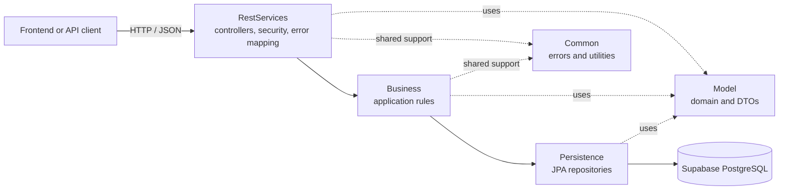
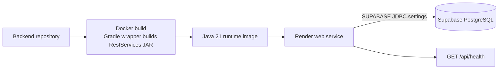

# Backend Architecture

## Purpose and runtime boundary

The backend is a Java 21, Spring Boot 3.5 application. It provides REST endpoints for authentication, users, organizations and memberships, events and registrations, event tasks, announcements, follow-ups, and messages. The API is consumed directly by the React frontend. PostgreSQL persistence is hosted in Supabase for the deployed service.

```text
HTTP client -> RestServices -> Business -> Persistence -> Supabase PostgreSQL
                              \-> Model / Common shared types and utilities
```



## Module structure

The Gradle multi-project build includes five modules:

| Module | Responsibility |
| --- | --- |
| `Model` | Domain entities and shared request/response DTOs. |
| `Common` | Shared errors, utilities, and cross-layer support. |
| `Persistence` | JPA repositories, query specifications, and database access. |
| `Business` | Service interfaces and implementations containing application rules and orchestration. |
| `RestServices` | Spring Boot entry point, REST controllers, security/configuration adapters, exception mapping, and API exposure. |

Within `RestServices`, `controllers`, `security`, `config`, and `errors` separate HTTP endpoints, authorization integration, infrastructure wiring, and error responses. Business services depend on persistence abstractions; controllers should delegate business behavior to services rather than access repositories directly.

## Configuration

Spring configuration is in `RestServices/src/main/resources/application.properties`. Runtime configuration is supplied through environment variables; the application optionally imports a repository-root `.env` file for local development.

| Variable | Purpose |
| --- | --- |
| `SUPABASE_JDBC_URL` | PostgreSQL JDBC connection URL. |
| `SUPABASE_DB_USERNAME` | Database username. |
| `SUPABASE_DB_PASSWORD` | Database password. |
| `JWT_SECRET` | Secret used for JWT signing/verification. |
| `PORT` | HTTP listener port in a container; defaults to `10000`. |

The schema mode is `validate`, so the application expects a compatible database schema instead of creating it at startup. OpenAPI JSON is served at `/v3/api-docs` and Swagger UI at `/swagger-ui.html`; health is exposed at `GET /api/health`. Never commit real `.env` values, database credentials, or JWT secrets. `.env.example` contains placeholders.

## Security and errors

JWT authentication is handled in `RestServices/security`. Organization-scoped authorization uses an interceptor and membership roles; organization membership is not encoded in the JWT. Request validation, status codes, and DTO mapping belong at the HTTP boundary. Business rules belong in `Business`, and database access belongs in `Persistence`. A global exception handler maps application errors to the shared error DTO and must not expose stack traces or internal exception details.

## Tests and local development

Tests are organized within their owning Gradle modules under `src/test`. Persistence and REST test resources include test-specific Spring properties; the repository README describes H2-backed test execution. Use the Gradle wrapper from this repository root:

```powershell
.\gradlew.bat clean test
.\gradlew.bat build
```

For local app execution, configure the environment (or local `.env`) and run `.\gradlew.bat bootRun`. Use JDK 21. Do not place credentials in commands or tracked files.

## Container build and deployment

The root `Dockerfile` is a multi-stage build. It builds the executable `RestServices` JAR with the Gradle wrapper on a Java 21 JDK image, then runs that JAR on a Java 21 JRE image. The process binds to `0.0.0.0` and uses `PORT` (default `10000`). The root `compose.yaml` starts only the backend container; it does not provision PostgreSQL or seed data. Required runtime values are injected from the environment/local ignored `.env` file.

The deployed service is hosted on Render and uses the existing Supabase PostgreSQL database. Render's Docker service configuration and secret values are managed in the Render dashboard; the repo README describes the manual setup. Verify `/api/health` after deployment. There is no database container in this deployment architecture.



## Operational limits

This document describes checked-in structure and the repository's deployment instructions. Hosting dashboards, database schema lifecycle/seed procedures, and production secret values are external operational configuration. Consult the repo README and the team's maintained API and architecture documentation for details beyond this implementation map.
